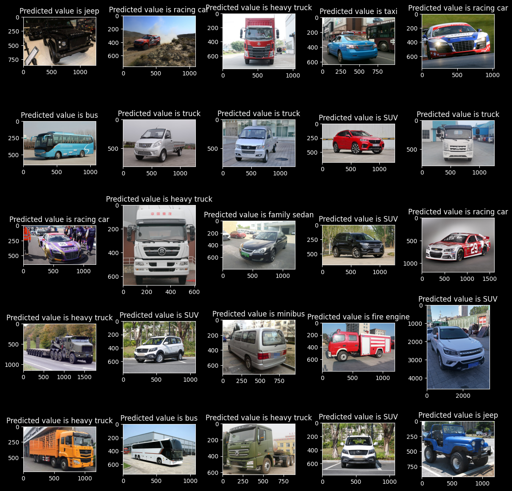
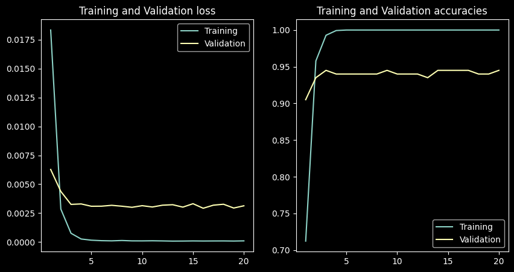

#  Vehicle Classification System



[](LICENSE)
[](https://www.python.org/)
[](https://pytorch.org/)
[](notebooks/train.ipynb)
[](https://github.com/Xer0bit/Vehicle-Car-MiniTruck-Truck-v2/releases)

## 🌟 Overview

The Vehicle Classification System is an advanced deep learning solution that accurately classifies vehicles into three categories: **Truck**, **Minitruck**, and **Car**. Built using PyTorch and ResNet50, the system provides high accuracy detection through multiple interfaces including a user-friendly GUI, web server, API, and service integrations.

- **Production-Ready**: Enterprise-grade vehicle classification with 94.5% validation accuracy
- **Pre-trained Model**: Ready to use without additional training
- **Multi-Platform**: Works on Windows, Linux, and macOS (service mode Windows-only)

## ✨ Features

- **Multi-class Vehicle Classification**: Accurately identify vehicles as Truck, Minitruck, or Car
- **Multiple Interface Options**:
  - Interactive Desktop GUI application
  - Web Server with browser interface
  - RESTful API for system integration
  - Windows Service for continuous operation
- **Discord Integration**: Real-time logging and notifications
- **Feedback Collection System**: Continuous model improvement through user feedback
- **Batch Processing**: Process multiple images at once
- **Model Retraining**: Update the model with new data through the retraining system

## 🔧 Installation

### Prerequisites

- Python 3.10 or newer
- Windows OS (for service deployment)
- 2GB+ RAM
- CUDA-compatible GPU (optional, for faster inference)

### Quick Setup

1. **Clone the repository**:
   ```
   git clone https://github.com/Xer0bit/Vehicle-Car-MiniTruck-Truck-v2.git
   cd Vehicle-Car-MiniTruck-Truck-v2
   ```

2. **Run the setup script**:
   ```
   # For Windows
   setup.bat
   
   # For PowerShell
   .\setup.ps1
   ```

3. **Activate the environment**:
   ```
   # For Windows
   activate_env.bat
   
   # For PowerShell
   & .\vision\Scripts\Activate.ps1
   ```

## 🚀 Usage

The system can be used in multiple ways:

### Desktop GUI Application

Run the GUI application for interactive classification:

```
python classifier_gui.py
```

Features:
- Drag and drop image support
- Batch processing
- Visual results with confidence scores
- Feedback submission for continuous learning

### Web Interface

Start the web server:

```
python web_server.py
```

Then access the web interface at http://localhost:5000

### API Usage

The system provides a RESTful API for integration with other applications. See [API_README.md](API_README.md) for detailed documentation.

Basic example:
```python
import requests

api_url = "http://localhost:5000/api/classify"
api_key = "your_api_key_here"
headers = {"X-API-Key": api_key}

with open("path/to/image.jpg", "rb") as image_file:
    files = {"image": image_file}
    response = requests.post(api_url, headers=headers, files=files)

result = response.json()
print(f"Classification: {result['class_name']} (Confidence: {result['confidence']:.2f})")
```

### Windows Service

To install as a Windows service:

```
install_service.bat
```

To start/stop the service:

```
run_service.bat
stop_service.bat
```

## 🔄 Model Retraining

The system collects feedback during operation, which can be used to continuously improve the model. To retrain with new data:

```
python retrain.py --data feedback_data/corrected_images/
```

### Retraining Workflow

1. System collects misclassified images in `feedback_data/`
2. User provides corrected labels through GUI or feedback form
3. Retrain model using the corrected dataset
4. Evaluate new model performance
5. Deploy updated model to production

For detailed information about the training process, see our [training notebook](notebooks/train.ipynb).

## 📊 Dataset & Model Performance

### Dataset

The model is trained on a comprehensive dataset of vehicle images organized in the following structure:

```
dataset/
    train/
        bus/          # Mini-truck category images
        ...           # Other vehicle class folders
    val/
        ...           # Validation data with same structure as train
    test/
        ...           # Test images for evaluation
```

The dataset includes various vehicle types that are mapped to three main categories:
- **Truck**: Heavy trucks and large commercial vehicles
- **Minitruck**: Buses, fire engines, and medium-sized trucks 
- **Car**: Personal vehicles and smaller automobiles

**[➡️ Download Dataset](https://piast92-my.sharepoint.com/:f:/g/personal/sameer_akram_smartgentech_net/Ek9z4s_schhHv0wvfOZsvpcBuzm3o7mrq37sL52F8GmfYw?e=oMypz7)**

### Model Performance



Our ResNet50-based model achieves excellent performance metrics:

| Metric | Train | Validation |
|--------|-------|------------|
| Accuracy | 100% | 94.5% |
| Loss | 0.000097 | 0.003131 |

These results were achieved after 20 epochs of training with the following configuration:
- Learning Rate: 0.1 with StepLR scheduler
- Batch Size: 64
- Image Size: 224x224
- Data Augmentation: Normalization with ImageNet stats

## 🛠️ System Architecture

- **Core Classification Engine**: PyTorch with ResNet50 architecture
- **UI Layer**: PyQt5 for desktop GUI
- **Web Server**: Flask for web interface and API
- **Service Layer**: Windows service integration using NSSM
- **Logging System**: Multi-level logging with Discord integration
- **Feedback System**: Data collection for continuous improvement

### Pretrained Model

The pretrained model files are stored in the `pt` directory:
```
pt/
    model_weights.pth   
    label_encoder.pth   
```

The system loads these files by default, providing immediate classification capabilities without requiring retraining.

**[⬇️ Download Pre-trained Model (108MB)](https://piast92-my.sharepoint.com/:f:/g/personal/sameer_akram_smartgentech_net/EqVoHeWwUpZAkeWnNxIIh2wBNX3rXRAR8NVfvorVtKQViA?e=BEXO7c)**

#### Model Architecture
- Base: ResNet50 (pretrained on ImageNet)
- Fine-tuned with transfer learning
- Input size: 224x224 RGB images
- Output: 3 classes (Truck, Minitruck, Car)

## 📝 Technical Documentation

For detailed information about specific components:

- [API Documentation](API_README.md)
- [Training Process](notebooks/train.ipynb)
- [System Deployment Guide](docs/deployment.md)

## 🤝 Contributing

Contributions are welcome! Please feel free to submit a Pull Request.

## 📄 License

This project is licensed under the MIT License - see the LICENSE file for details.

##  Benchmarks

Performance benchmarks on various hardware configurations:

| Hardware | Processing Time (ms/image) | FPS |
|----------|----------------------------|-----|
| NVIDIA RTX 3080 | 8.2 ms | 122 |
| NVIDIA GTX 1660Ti | 12.7 ms | 79 |
| Intel i9-12900K (CPU) | 34.5 ms | 29 |
| Raspberry Pi 4 | 312 ms | 3.2 |

## 📚 Citation

If you use this model in your research or project, please cite:

```bibtex
@software{xer0bit2025vehicle,
  author = {Xer0bit},
  title = {Vehicle-Car-MiniTruck-Truck Classification System},
  year = {2025},
  url = {https://github.com/Xer0bit/Vehicle-Car-MiniTruck-Truck-v2},
  version = {2.0}
}
```

## Acknowledgements

- ResNet architecture by Microsoft Research
- PyTorch team for the deep learning framework
- Dataset contributors for training data

---

© 2025 BitLogicX | Vehicle Classification System v2.0 | [xer0bit.com](https://xer0bit.com)
